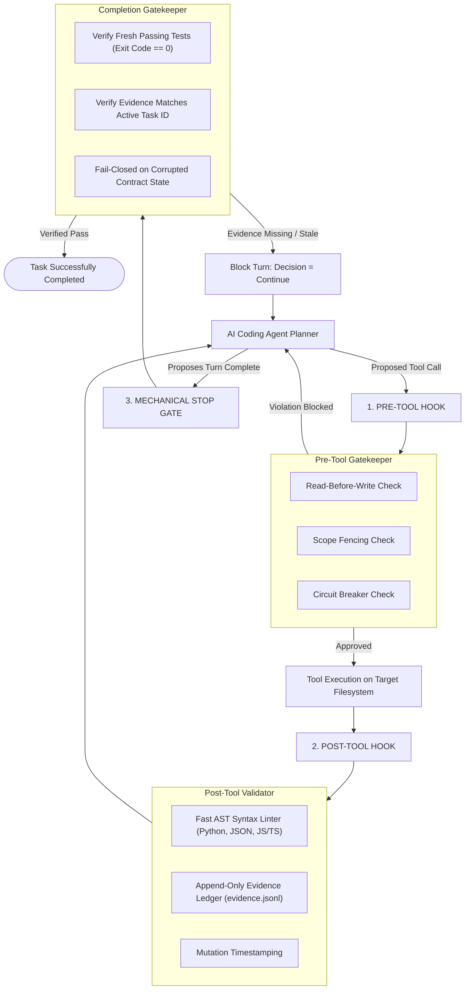

# Universal Frontier Harness (v7.1.1)

[](CHANGELOG.md)
[](https://github.com/dopesir/universal-frontier-harness/actions/workflows/test.yml)
[](tests/)
[](https://www.python.org/)
[](LICENSE)
[](#zero-dependencies)
[](#cross-platform)

**A deterministic reliability runtime and senior-SWE operational framework for autonomous AI coding agents.**

The Universal Frontier Harness eliminates model-specific behavioral divergence, context drift, and premature completion claims by combining **lean, high-attention prompt invariants** with **zero-bypass mechanical runtime hooks**.

---

## Why Purely Textual Prompts Fail

Even frontier LLMs with 1M+ token context windows suffer from structural attention dynamics when loaded with large, passive rule catalogs:

1. **Attention Dilution & Softmax Saturation**: As an agent accumulates file reads and compiler outputs (30k–100k tokens), the softmax attention probability mass assigned to passive rules in the system prompt degrades to under 5%.
2. **Lost-in-the-Middle Effect**: Standard transformers exhibit a U-shaped recall curve. Mid-context instructions are systematically skipped or forgotten.
3. **Autoregressive Self-Conditioning**: When an agent outputs *"The bug is fixed and tests pass"* without running them, that hallucination becomes ground-truth context in subsequent turns.
4. **Unaided Self-Correction Failure**: Prompting an agent to "double check its work" without external mechanical validators results in self-reinforcing rationalizations.

---

## Execution Lifecycle



---

## The 6 Non-Negotiable Invariants

1. **Reconnaissance Before Mutation (Read-Before-Write)**: Always inspect existing files before editing. Mutating an unread file is blocked mechanically by `pre_tool.py`.
2. **Reproduce Before Repair**: Never modify production code to fix a defect without first authoring an isolated, runnable reproduction check that empirically fails.
3. **Surgical Diff Principle**: Make the smallest viable AST perturbation. Never rewrite entire classes or files when a targeted 3-line guard clause suffices.
4. **Evidence-First Completion**: Claims without executed test exit codes (`exit_code == 0`) are rejected. Code that "looks correct" is NOT verified.
5. **Circuit Breakers**: If an action, command, or test fails **twice** with the same error, STOP immediately and switch from execution mode to diagnostic mode.
6. **Caller Invariance**: Never break public API signatures, delete docstrings, or weaken existing tests to force a build to pass.

---

## The Ponytail YAGNI Ladder

When adding or modifying logic, stop at the first rung that holds:

```
1. Does this need to exist at all?
   └── (YAGNI — if speculative or decorative, delete it).
2. Can stdlib/native platform features cover it?
   └── (Reach for built-in libraries before custom abstractions).
3. Does an already-installed dependency solve it?
   └── (Never add a library for what existing packages already do).
4. Can it be one line?
   └── (One line).
5. Only then:
   └── Write the minimum code that satisfies the test.
```

---

## Graph-Aware Intelligence & Blast-Radius Engine

The harness features an ultra-lean, zero-dependency dependency graph and blast-radius evaluation engine (`core/graph_intel.py`).

> [!IMPORTANT]
> **No Graphify Initialization Required**: You do **NOT** have to install, configure, or initialize Graphify. The Universal Frontier Harness includes a built-in native AST dependency graph engine that runs out of the box using pure Python standard library. If Graphify's output (`graphify-out/graph.json` or `.graphify/graph.json`) is present in your workspace, the harness will automatically detect and consume it; otherwise, the native engine provides full blast-radius protection with zero setup.

### How It Works
1. **Asymmetric Silence**: Safe edits pass silently with **0 tokens of prompt overhead** and `<0.3ms` cached lookup latency.
2. **Blast-Radius Protection**: When an agent attempts to mutate a high-blast-radius file (depended on by 5+ files) without inspecting any dependent callers, the harness emits a surgical advisory in `pre_tool.py` to prevent cascading breaks across public signatures.
3. **Symbol Map Risk Annotations**: Run `python skills/ast-repo-mapper/scripts/repo_map.py . --with-blast-radius` to generate a high-density AST symbol map annotated with risk levels (`NONE`, `LOW`, `MEDIUM`, `HIGH`) and caller counts.
4. **CLI Diagnostics**:
   ```bash
   python -m core.graph_intel status
   python -m core.graph_intel blast-radius core/policy.py
   python -m core.graph_intel dependents core/policy.py
   ```

---

## Harness² Recursive Self-Improvement & Spatial Workbench

### 1. Harness² Continual Learning Architecture
Inspired by Google Cloud AI Research's Harness² (*Recursive Agent Harnessing for an Open World*), the framework operates on frozen model weights while recursively optimizing execution scaffolding:
- **`scripts/harness_rsi.py --audit`**: Inspects the entire active harness footprint across rules, memory, and skills, enforcing a hard context limit ($\le 25\text{k}$ tokens) to prevent prompt degradation.
- **`scripts/harness_rsi.py --log`**: Appends empirical execution lessons, observed failure modes, and verified fixes into a persistent continual learning repository (`.agents/memory/experience.md`).

### 2. Spatial Multi-Viewport Workbench
To eliminate mobile and responsive design blindness, the included HTTP daemon provides live multi-device simulation:
```bash
python scripts/serve_preview.py /path/to/project --port 5185
```
- Standard application view: `http://localhost:5185`
- Spatial multi-viewport workbench: `http://localhost:5185/__spatial__` (renders Desktop $1440\text{px}$, Tablet $768\text{px}$, and Mobile $390\text{px}$ concurrently in real time).

### 3. Zero-Remote Asset Sandboxing (`SLOP-11`)
Section 4 enforces local caching for all fonts, 3D meshes, textures, and media inside `assets/`. Deliverables relying on raw external CDNs or Unsplash URLs fail closed.

---

## Quickstart & Installation

Install the complete runtime into any target repository in one command:

```bash
python scripts/init_harness.py /path/to/your/project
```

### Safety Features
- **Safe by default**: Pre-existing `AGENTS.md` or hook configurations are preserved (`[SKIP]`).
- **Dry-run mode**: Preview all planned changes without modifying disk:
  ```bash
  python scripts/init_harness.py /path/to/your/project --dry-run
  ```
- **Explicit overwrite & backups**: Replace files while creating automated `.bak.<timestamp>` archives:
  ```bash
  python scripts/init_harness.py /path/to/your/project --overwrite
  ```
- **Clean uninstallation**: Remove harness runtime while strictly preserving user memory notes:
  ```bash
  python scripts/init_harness.py /path/to/your/project --uninstall
  ```

### Verify System Health
Run the self-test suite (50 automated unit, integration, and adversarial tests):
```bash
python -m unittest discover tests
python scripts/verify_harness.py
```

---

## Documentation Suite

Detailed guides and specifications are available in [`docs/`](docs/):

- 📦 **[Installation Guide](docs/INSTALLATION.md)** — Options, layouts, safe defaults, and uninstallation.
- 🏛️ **[Architecture & Invariants](docs/ARCHITECTURE.md)** — In-depth hook lifecycle, state machine, and YAGNI ladder.
- 🌐 **[Host Compatibility Matrix](docs/COMPATIBILITY.md)** — Verified support across Antigravity, Claude Code, Cursor, and Windsurf.
- 🔧 **[Troubleshooting & FAQs](docs/TROUBLESHOOTING.md)** — Common gate blocks, unread file errors, and resolutions.
- 📊 **[Benchmark Protocol](BENCHMARK_PROTOCOL.md)** — Controlled empirical evaluation methodology and pilot tasks.
- 🛡️ **[Security Policy](SECURITY.md)** — Privacy guarantees, local execution, and responsible disclosure.
- 📝 **[Changelog](CHANGELOG.md)** — Version history and release notes.
- 🤝 **[Contributing](CONTRIBUTING.md)** — PR guidelines and development setup.

---

<a id="zero-dependencies"></a><a id="cross-platform"></a>
## Cross-Platform Engineering & Zero Dependencies

- **Zero Third-Party Dependencies**: The entire core engine, AST linter, evidence ledger, and hook scripts run purely on Python 3.10+ standard library.
- **100% Cross-Platform Hardened**: Native UTF-8 streaming eliminates Windows charmap encoding bugs, and `pathlib.Path` normalization ensures identical execution across Linux, macOS, and Windows.

---

## Acknowledgments & Prior Art

We gratefully acknowledge:
* **[Gravitas by Uday Sharma (@udaysharmadev)](https://github.com/udaysharmadev/Gravitas)** for pioneering completion stop gates and failure mode taxonomies.
* **[SWE-agent (Princeton NLP)](https://github.com/princeton-nlp/SWE-agent)** for the Agent-Computer Interface (ACI).
* Academic research by Yao et al. (ReAct), Wang et al. (Plan-and-Solve), and Dhuliawala et al. (Chain-of-Verification).

---

## License

MIT License. See [LICENSE](LICENSE) for details.
